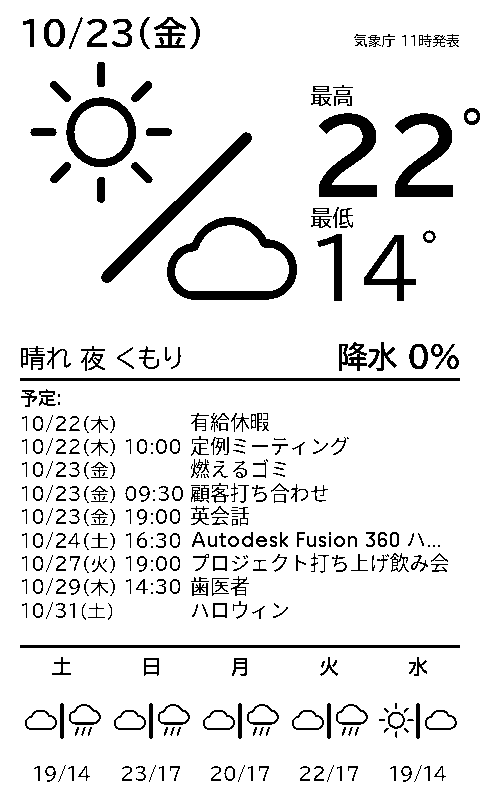

# trmnl-dashboard

[kindle-wallpaper-jp](https://github.com/ichusrlocalbin/kindle-wallpaper-jp) の [TRMNL](https://trmnl.com) 版です。壁に掛けた TRMNL OG に、明日の天気（気象庁）と Google カレンダーの予定を、日本語で表示します。



- **明日の天気を大きく表示**：遠くからでも読めるように、画面の上半分を使います。天気の図、最高・最低気温、天気の文章、降水確率を出します
- **今日以降の予定**：日付・時刻・予定名を表の形で並べます。終日の予定は時刻を空欄にします
- **週間予報**：明後日から 6 日分を表示します
- **日本語の字形で表示**：TRMNL の標準のままだと、漢字が中国語の字形（Noto Sans CJK SC）になります。そうならないよう、日本語用のフォント設定を読み込みます
- **天気の記号**：「のち」は「/」、「時々」は「|」で表します（新聞の天気記号と同じ）。時々の方の天気は小さく描きます
- **自前のサーバーは不要**：描画もデータの取得も、TRMNL のサーバーが行います

## 仕組み

TRMNL の端末は、サーバーから受け取った画像を表示するだけです。画面の HTML は TRMNL のサーバーが描画し、画像にして端末へ送ります。このリポジトリにあるのは、TRMNL に登録する Private Plugin（Liquid テンプレートと設定）です。

```
                       TRMNL のサーバー
┌──────────────────────────────────────────────────────────┐
│  Google Calendar（公式プラグイン）──────┐  プレイリストで非表示 │
│                                          ▼                │
│  jma-weather（Private Plugin）──────► dashboard（Private Plugin）│
│    気象庁の予報 JSON を取得し、          2 つのデータを受け取り │
│    transform で整形する                  （Plugin Merge）、     │
│    プレイリストで非表示                  画面を描く            │
└──────────────────────────────────────────┼───────────────┘
                                           ▼  PNG（1-bit / 2-bit）
                                       TRMNL OG（縦向き）
```

| ディレクトリ | 内容 |
|---|---|
| `plugins/jma-weather/` | 気象庁の予報 JSON を Polling で取得し、`src/transform.js` で画面用に整形する |
| `plugins/dashboard/` | 画面本体。Plugin Merge で天気と予定を受け取り、描画する |
| `plugins/device-font-test/` | 実機で日本語フォントを見比べるためのテスト画面 |
| `experiments/` | 日本語フォントと天気アイコンの検証（結果は各 README） |
| `docker/trmnl-render/` | ローカルで描画を確認するための Docker イメージ。trmnlp に、本番の描画サーバーと同じ Noto Sans CJK を加えたもの |
| `bin/` | `trmnlp`（上のイメージで trmnlp を実行する）と、`trmnl-render`（PNG を書き出す） |
| `docs/DESIGN.md` | 設計と、検討の経緯 |

## 必要なもの

- **TRMNL OG**：800×480 の画面を縦向きで使います
- **TRMNL の Developer Edition**：Private Plugin を使うために必要です
- **Google アカウント**：予定を表示するカレンダーがあるもの
- **Docker**：プラグインの登録と、ローカルでの描画確認に使います。Ruby や trmnlp を手元に入れる必要はありません

## 使い方

### 1. TRMNL の API キーを用意する

TRMNL のアカウント設定（https://trmnl.com/account）で **Account API key** を確認します。Device API key ではありません。

キーは、リポジトリ直下の `.trmnl-api-key` というファイルに 1 行で書いて保存します。このファイルは git の管理対象から外してあります。`bin/trmnlp` は、環境変数 `TRMNL_API_KEY` がなければこのファイルから読みます。キーをコマンドに直接書くと、シェルの履歴に残ってしまいます。

### 2. Google カレンダーを接続する

1. TRMNL の Plugins で **Google Calendar** を開き、Google アカウントを接続します
2. 表示するカレンダーを選びます。予定を数日先まで出したいときは、レイアウトを Week（5〜7 日分）にします
3. プレイリストに追加し、目のアイコンで**非表示**にします。非表示でもデータは更新されます

### 3. 天気のプラグイン（jma-weather）を登録する

```sh
bin/trmnlp plugins/jma-weather push
```

TRMNL に Private Plugin が作られます。

> **このリポジトリを fork して使う場合**：`plugins/*/src/settings.yml` に作者の TRMNL のプラグイン ID（`id:` の行）が入っています。最初の `push` の前に、その行を消してください。消さないと、他人のプラグインを更新しようとして失敗します。

1. `plugins/jma-weather/src/settings.yml` に、TRMNL から割り当てられた `id` が書き込まれます。手元に残しておきます
2. TRMNL 上でこのプラグインをプレイリストに追加し、**非表示**にします

### 4. 画面のプラグイン（dashboard）を登録する

```sh
bin/trmnlp plugins/dashboard push
```

1. TRMNL 上でこのプラグインの設定を開きます
2. 「天気」で手順 3 の jma-weather を、「予定」で手順 2 の Google Calendar を選びます
3. プレイリストに追加します。これだけは**表示**のままにします

### 5. 端末を設定する

TRMNL の Devices > Settings で、次のように設定します。

- **向き**：縦向き（portrait）
- **更新間隔**：1 時間。気象庁の予報は 1 日 3 回（5 時・11 時・17 時）しか発表されないので、これで十分です
- **スリープモード**：夜間（例：22 時〜6 時）は更新を止めると、バッテリーが長持ちします。「スリープ画面」をオフにすると、スリープ中も最後の表示が残ります
- **2-bit（4 階調グレー）**：ファームウェア 1.6.0 以降なら選べます。白黒のままでも読めるように作っていますが、好みで選んでください

## 地域を変える

初期設定は東京（東京地方）です。ほかの地域にする場合は、次の 3 か所を変えます。

| 場所 | 値 | 東京の例 |
|---|---|---|
| `plugins/jma-weather/src/settings.yml` の `polling_url` | 府県予報区のコード | `130000`（東京都） |
| `plugins/jma-weather/src/transform.js` の `AREA_CODE` | 一次細分区域（天気・降水確率）のコード | `130010`（東京地方） |
| `plugins/jma-weather/src/transform.js` の `CITY_CODE` | 気温の観測地点のコード | `44132`（東京） |

コードは、`https://www.jma.go.jp/bosai/forecast/data/forecast/<府県予報区のコード>.json` の中の `areas[].area.code` で確認できます。

## ローカルで確認する

TRMNL に登録しなくても、手元で画面を PNG にできます。描画には `docker/trmnl-render` のイメージを使います（初回に自動でビルドされます）。

```sh
bin/trmnlp plugins/jma-weather build            # 気象庁から天気を取得する（.cache/ に保存）
bin/trmnlp plugins/dashboard test --update      # 縦向きの画面を描く
open plugins/dashboard/tests/snapshots/linux/portrait-og_png.png
```

- 天気は、直前に取得した気象庁の本物のデータを使います
- 予定は、`plugins/dashboard/fixtures/google-calendar/` の仮のデータを使います
- 天気アイコンの一覧は `bin/trmnlp experiments/weather-icons test --update` で描けます

会社のプロキシなどで HTTPS の通信が検査されていて、証明書のエラーで取得に失敗する場合があります。そのときは、そのネットワークのルート CA 証明書（PEM）を `docker/trmnl-render/extra-ca/` に `*.crt` という名前で置いてください。この証明書は git の管理対象から外してあります。

## 注意

- 気象庁の予報 JSON は、気象庁の Web サイトが表示に使っているデータです。仕様が公開された API ではないので、予告なく形式が変わる可能性があります
- 公式の Google Calendar プラグインが渡すデータの形式は、ドキュメントに書かれていません。仮のデータは Google Calendar API の形式（`summary`、`start.dateTime`、`start.date`）に合わせています。実際のデータと違う場合は、`plugins/dashboard/src/full.liquid` の予定の部分を直してください
- フォント（BIZ UDPGothic）は、描画のたびに Google Fonts から読み込みます。ローカルの描画では、まれに読み込みが間に合わず白い画面になります。そのときは、もう一度描画してください

## クレジット

- 元になったプロジェクト：[ichusrlocalbin/kindle-wallpaper-jp](https://github.com/ichusrlocalbin/kindle-wallpaper-jp)
- 天気アイコンの一部（雲・雷）：kindle-wallpaper-jp と [pjimenezmateo/kindle-wallpaper](https://github.com/pjimenezmateo/kindle-wallpaper) のもの（[CC BY 4.0](https://creativecommons.org/licenses/by/4.0/)）。詳細は `plugins/dashboard/icons/kindle-wallpaper-jp/README.md`
- 天気予報：[気象庁](https://www.jma.go.jp/)
- フォント：[BIZ UDPGothic](https://fonts.google.com/specimen/BIZ+UDPGothic)（SIL Open Font License）
- ローカルの描画：[trmnlp](https://github.com/usetrmnl/trmnlp)

## ライセンス

[MIT](LICENSE)。ただし、`plugins/dashboard/icons/kindle-wallpaper-jp/` のアイコンと、それを元にした `plugins/dashboard/src/shared.liquid` 内の雲・雷のアイコンは [CC BY 4.0](https://creativecommons.org/licenses/by/4.0/) です。
