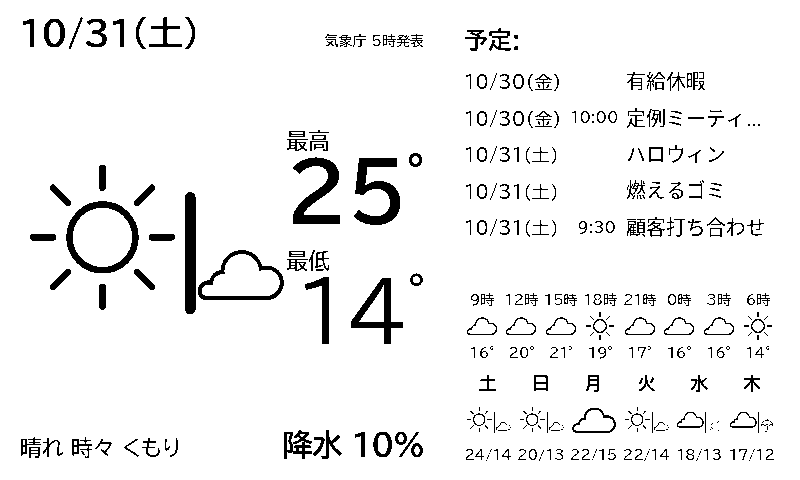
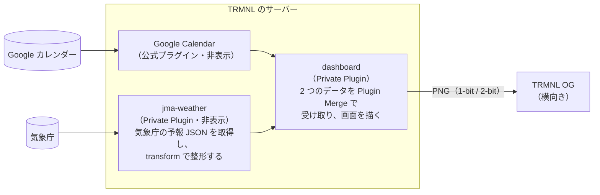

# trmnl-dashboard

[kindle-wallpaper-jp](https://github.com/ichusrlocalbin/kindle-wallpaper-jp) の [TRMNL](https://trmnl.com) 版です。壁に掛けた TRMNL OG に、明日の天気（気象庁）と Google カレンダーの予定を、日本語で表示します。



- **明日の天気を大きく表示**：遠くからでも読めるように、画面の左半分を使います。天気の図、最高・最低気温、天気の文章、降水確率を出します
- **今日以降の予定**：右上に、日付・時刻・予定名を表の形で並べます。終日の予定は時刻を空欄にします
- **3 時間ごとの天気**：週間予報の上に、今から 24 時間分（8 コマ）の天気と気温を並べます。気象庁の「地域時系列予報」を使います。1 時間ごとのデータは気象庁にありません
- **週間予報**：右下に、明後日から 6 日分を表示します
- **日本語の字形で表示**：TRMNL の標準のままだと、漢字が中国語の字形（Noto Sans CJK SC）になります。そうならないよう、日本語用のフォント設定を読み込みます
- **天気の記号**：「のち」は「/」、「時々」は「|」で表します（新聞の天気記号と同じ）。時々の方の天気は小さく描きます
- **自前のサーバーは不要**：描画もデータの取得も、TRMNL のサーバーが行います

## 仕組み

TRMNL の端末は、サーバーから受け取った画像を表示するだけです。画面の HTML は TRMNL のサーバーが描画し、画像にして端末へ送ります。このリポジトリにあるのは、TRMNL に登録する Private Plugin（Liquid テンプレートと設定）です。



| ディレクトリ | 内容 |
|---|---|
| `plugins/jma-weather/` | 気象庁の予報 JSON を Polling で取得し、`src/transform.js` で画面用に整形する |
| `plugins/dashboard/` | 画面本体。Plugin Merge で天気と予定を受け取り、描画する |
| `plugins/device-font-test/` | 実機で日本語フォントを見比べるためのテスト画面 |
| `experiments/` | 日本語フォントと天気アイコンの検証（結果は各 README） |
| `docker/trmnl-render/` | ローカルで描画を確認するための Docker イメージ。trmnlp に、本番の描画サーバーと同じ Noto Sans CJK を加えたもの |
| `bin/` | `trmnlp`（上のイメージで trmnlp を実行する）と、`trmnl-render`（PNG を書き出す） |
| `docs/DESIGN.md` | 設計と、検討の経緯 |

## 必要なもの

- **TRMNL OG**：800×480 の画面を横向きで使います
- **TRMNL の Developer Edition**：Private Plugin を使うために必要です。ライセンスはアカウントではなく端末に紐づきます
- **Google アカウント**：予定を表示するカレンダーがあるもの
- **Docker**：プラグインの登録と、ローカルでの描画確認に使います。Ruby や trmnlp を手元に入れる必要はありません

## 使い方

TRMNL の初期設定（Wi-Fi への接続とアカウント登録）が終わり、端末に「こんにちは、〇〇さん」と表示された状態から始めます。設定は、パソコンのブラウザで [TRMNL の Web 管理画面](https://trmnl.com)から行います。

### 1. 事前に確認する

- **Developer Edition**：画面右上のメニューから端末を選び、端末の設定ページを開きます。下の方に「Developer Perks（開発者向け特典）」の欄があれば有効です
- **ファームウェア**：同じページに表示されます（例：`Current firmware: 1.8.17`）。2-bit（4 階調グレー）を使うには 1.6.0 以上が必要です

### 2. TRMNL の API キーを用意する

[アカウント設定](https://trmnl.com/account)で **Account API key** を確認します。プラグインの登録に使います。同じ画面にある Device API key は、端末が画面を取りに来るためのもので、ここでは使いません。

キーは、リポジトリ直下の `.trmnl-api-key` というファイルに 1 行で書いて保存します。テキストエディタで作ってください。

- このファイルは git の管理対象から外してあります
- `bin/trmnlp` は、環境変数 `TRMNL_API_KEY` がなければこのファイルから読みます
- キーをコマンドに直接書くと、シェルの履歴や、画面を共有している相手（AI アシスタントとの会話も含みます）に残ります。うっかり見せてしまったら、アカウント設定でキーを作り直してください

### 3. Google カレンダーを接続する

1. Plugins で **Google Calendar** を開き、Google アカウントを接続します
2. 表示するカレンダーを選びます。複数のカレンダーを選ぶこともできます
3. レイアウトを **Month** にします。今日から 6 週間先（42 日後）までの予定が、dashboard に渡されます。「過去の予定を含める」設定はオフのままにします
4. プレイリストに **Full screen** で追加し、目のアイコンで**非表示**にします

#### 予定を取れる範囲

Google Calendar プラグインが dashboard に渡す予定の範囲は、**レイアウトで決まります**。何日先まで取るかを直接決める設定はありません。範囲は「今日の 0 時から N 日後まで」で、週の始まりの曜日や「週を固定する」設定には左右されません（[プラグインのソース](https://github.com/usetrmnl/plugins/blob/master/lib/google_calendar/google_calendar.rb) の `time_min` と `time_max`）。

| レイアウト | 先の範囲 | 過去の予定を含める設定にしたとき |
|---|---|---|
| Week、Rolling Week、Work Week | 7 日後まで | 7 日前から |
| Default など、ほかのレイアウト | 7 日後まで | 含まれない |
| Month、Rolling Month | 42 日後まで（6 週間） | 30 日前から |
| Schedule | 14 日後まで（予定がなければ 21 日後まで） | 含まれない |
| Today only | 1 日（今日だけ） | 含まれない |

- dashboard は今日以降の予定を近い順に最大 5 件表示します。そのため、Month にして範囲を広げても、表示が増えすぎることはありません
- 過去の予定は表示しないので、「過去の予定を含める」設定はオフのままにします

### 4. 天気のプラグイン（jma-weather）を登録する

```sh
bin/trmnlp plugins/jma-weather push
```

TRMNL に Private Plugin「気象庁 天気（東京）」が作られます。

> **このリポジトリを fork して使う場合**：`plugins/*/src/settings.yml` に作者の TRMNL のプラグイン ID（`id:` の行）が入っています。最初の `push` の前に、その行を消してください。消さないと、他人のプラグインを更新しようとして失敗します。初回の `push` で、あなたのプラグイン ID が書き込まれます。

1. 表示された URL（`https://trmnl.com/plugin_settings/<id>/edit`）で設定画面を開き、**Force Refresh** を押します。登録直後はまだデータを取りに行っていないので、プレビューは灰色の線だけになっています。押すと、天気の文章・気温・降水確率が表示されます
2. プレイリストに **Full screen** で追加し、**非表示**にします

プラグインの一覧画面（Plugins > Private Plugin）にある「追加」は押さないでください。新しい空のプラグインが作られてしまいます。

### 5. 画面のプラグイン（dashboard）を登録する

```sh
bin/trmnlp plugins/dashboard push
```

1. 表示された URL で設定画面を開き、次の項目を選んで**保存**します
   - **天気**：手順 4 の「気象庁 天気（東京）」
   - **予定**：手順 3 の Google Calendar
   - **デバッグ表示**：「しない」のままにします（[困ったとき](#困ったとき)を参照）
2. 「天気」「予定」の選択肢には、プレイリストに入っているプラグインだけが出ます。出てこないときは、先に手順 3・4 のプレイリストへの追加を済ませてください
3. プレイリストに **Full screen** で追加します。これだけは**表示**のままにします
4. 最初の「Welcome」の画面は、非表示にするかプレイリストから外します。残っていると、dashboard と交互に表示されます
5. 端末の背面のボタンを押します。追加したばかりのプラグインは、端末が次に画面を取りに来るまで描かれません。プレイリストの欄が空のままなのはそのためです

プレイリストの最終的な状態は次のとおりです。

| プラグイン | 表示 |
|---|---|
| 天気と予定（dashboard） | **表示** |
| 気象庁 天気（東京） | 非表示 |
| Google Calendar | 非表示 |
| Welcome | 非表示（または削除） |

非表示のプラグインも、dashboard が読んでいる限りデータは更新されます。ただし、プレイリストから外すと更新されなくなります。

### 6. 端末を設定する

端末の設定ページ（Devices > Settings）で、次のように設定します。

| 項目 | 設定 | 理由 |
|---|---|---|
| Refresh Rate | **2 時間** | 気象庁の予報は 1 日 3 回（5 時・11 時・17 時）しか出ないので、2 時間で十分です。予定の反映を早くしたいなら 1 時間にします |
| Sleep Mode | **オン、20:00〜11:00** | 夜は更新を止めて、電池を長持ちさせます。20 時前に描いた「明日」の天気が残るので、朝はその日の天気が見えます。11 時に起きると、次の日の天気に変わります |
| Sleep Screen | **オフ**（初期値） | オフなら、スリープ中も最後の表示が残ります |
| Image Rotation | **なし**（初期値） | 横向きのレイアウトなので、回転は要りません。上下を逆さまに掛ける場合だけ 180 度にします |
| 2-bit（4 階調グレー） | 好みで | 白黒のままでも読めるように作っています |

Sleep Mode は、時刻を入れただけでは有効になりません。スイッチがオンになっているか確認してください。

#### 更新の間隔

更新の間隔は、端末の設定とプラグインの設定の 2 種類があり、それぞれ別のものです。

| 設定 | 場所 | 何の間隔か | このリポジトリでの値 |
|---|---|---|---|
| **Refresh Rate** | 端末の設定 | 端末が目を覚まし、画像を取りに来て、画面を書き換える間隔 | 2 時間（スリープ中は止まる） |
| **Refresh interval**（画面では Max Refresh Rate など） | 各プラグインの設定 | TRMNL のサーバーがデータを取り直し、画像を作り直す間隔。Polling のプラグインでは、データを取りに行く間隔でもある | jma-weather：60 分<br>dashboard：60 分<br>Google Calendar：初期値（15 分） |

- **電池に効くのは Refresh Rate だけです**。プラグインの間隔はサーバーの中の作業なので、短くしても端末は起きません。プラグインの間隔を Refresh Rate より短くしておくと、端末が起きたときに、いつもほぼ最新の画面を持っていけます
- 画面の情報は、最大で「プラグインの間隔＋Refresh Rate」だけ古くなります。今の設定なら、天気はおよそ 3 時間です
- jma-weather と dashboard の間隔は、それぞれの `src/settings.yml` の `refresh_interval`（分）で決めています。Web の設定画面で変えても、`push --force` をするとこの値に戻ります。変えるなら `settings.yml` を直してから push してください

### 壁に掛ける

本体背面の、上がとがった三角形の穴を使います。壁に打ったくぎや細いネジの頭を、穴の広い下側から入れて、上のとがった部分に引っ掛けます。穴は横長の本体の上辺の中央にあるので、横向きにまっすぐ掛かります。

USB-C の端子と電源スイッチは背面の端にあるので、充電するときは本体を外します。

### Wi-Fi を変更する

Wi-Fi は Web の管理画面ではなく、端末の側で設定し直します。最初のセットアップと同じ流れです。

1. 電源が入った状態で、背面のボタンを 5〜8 秒押し続けてから離します。うまくいかなければ 15〜20 秒押し続けます
2. 端末が Wi-Fi ペアリングモードになり、画面に案内が出ます
3. スマホで TRMNL のネットワークにつなぎ、表示される画面で新しい Wi-Fi を選んでパスワードを入れます

- WPA2 Enterprise（ユーザー名とパスワードでログインする形式）の Wi-Fi にはつなげません
- 端末が反応しなくなったら、電源スイッチを 10 秒ほど OFF にしてから ON に戻します。登録済みの Wi-Fi が見つからないときは、自動でペアリングモードに戻ります
- Wi-Fi を変えても、TRMNL のアカウントやプレイリストの設定はそのまま残ります

詳しくは [TRMNL Help: Enable WiFi pairing mode](https://help.trmnl.com/en/articles/11511577-enable-wifi-pairing-mode) を参照してください。

### 7. 変更を反映する

テンプレートや設定を直したら、もう一度 `push` します。2 回目以降は、サーバーの設定を上書きしてよいかの確認（y/n）が出ます。入力できない環境では `--force` を付けます。

```sh
bin/trmnlp plugins/dashboard push --force
```

反映したら、端末の背面のボタンを押すと、すぐに表示が変わります。端末は Refresh Rate の間隔でしか画面を取りに来ないので、ボタンを押さないと、次の更新（最長 2 時間後）まで変わりません。Web の設定ページの **Refresh now** は「次に端末が来たときに新しい画面を渡す」予約なので、これだけではすぐには変わりません。

## 地域を変える

初期設定は東京（東京地方）です。ほかの地域にする場合は、次の 4 か所を変えます。

| 場所 | 値 | 東京の例 |
|---|---|---|
| `plugins/jma-weather/src/settings.yml` の `polling_url`（1 行目） | 府県予報区のコード | `130000`（東京都） |
| `plugins/jma-weather/src/settings.yml` の `polling_url`（2 行目） | 一次細分区域のコード | `130010`（東京地方） |
| `plugins/jma-weather/src/transform.js` の `AREA_CODE` | 一次細分区域（天気・降水確率）のコード | `130010`（東京地方） |
| `plugins/jma-weather/src/transform.js` の `CITY_CODE` | 気温の観測地点のコード | `44132`（東京） |

コードは、`https://www.jma.go.jp/bosai/forecast/data/forecast/<府県予報区のコード>.json` の中の `areas[].area.code` で確認できます。

## ローカルで確認する

TRMNL に登録しなくても、手元で画面を PNG にできます。描画には `docker/trmnl-render` のイメージを使います（初回に自動でビルドされます）。

```sh
bin/trmnlp plugins/jma-weather build            # 気象庁から天気を取得する（.cache/ に保存）
bin/trmnlp plugins/dashboard test --update      # 画面を描く（1-bit と 2-bit）
open plugins/dashboard/tests/snapshots/linux/landscape-og_png.png
```

- 天気は、直前に取得した気象庁の本物のデータを使います
- 予定は、`plugins/dashboard/fixtures/google-calendar/` の仮のデータを使います
- 天気アイコンの一覧は `bin/trmnlp experiments/weather-icons test --update` で描けます

会社のプロキシなどで HTTPS の通信が検査されていて、証明書のエラーで取得に失敗する場合があります。そのときは、そのネットワークのルート CA 証明書（PEM）を `docker/trmnl-render/extra-ca/` に `*.crt` という名前で置いてください。この証明書は git の管理対象から外してあります。

## 困ったとき

| 症状 | 原因と対処 |
|---|---|
| jma-weather のプレビューが灰色の線だけ | まだデータを取りに行っていません。設定画面で Force Refresh を押します |
| dashboard の天気が空で、気温が「-」 | 「天気」「予定」の選択が保存されていません。dashboard の設定画面で選び直して、保存します |
| 予定が「予定なし」 | 選んだカレンダーに、今日以降の予定が入っているか確認します。入れた直後なら、Google Calendar プラグインの設定画面で Force Refresh を押してから、端末の背面のボタンを押します |
| プレイリストの Add Plugin で追加できない | Account API で追加できます（下記） |
| 設定画面の「Updated just now. Your TRMNL shows this at its next check-in.」 | 端末は次に画面を取りに来たときに表示を変えます。すぐ見たいときは、端末の背面のボタンを押します |
| push で `Description is too long (maximum is 35 characters)` | `settings.yml` の `description` を 35 文字以内にします |

### データの中身を確かめる

dashboard の「デバッグ表示」を「する」にすると、通常の画面の代わりに、受け取ったデータがそのまま文字で表示されます。

プレビューが更新されないときは、Account API で直接確かめられます。

```sh
KEY=$(tr -d '[:space:]' < .trmnl-api-key)

# dashboard から参照できるデータ（天気・予定・選択した値）
curl -s -H "Authorization: Bearer $KEY" https://trmnl.com/api/plugin_settings/<dashboard の id>/merge_variables

# プレイリストの中身（項目の id、表示・非表示）
curl -s -H "Authorization: Bearer $KEY" https://trmnl.com/api/playlists/items

# プレイリストにプラグインを追加する（端末の id は playlists/items の device_id）
curl -s -X POST -H "Authorization: Bearer $KEY" -H 'Content-Type: application/json' \
  -d '{"plugin_setting_id": <プラグインの id>}' https://trmnl.com/api/devices/<端末の id>/playlist_items

# プレイリストの項目を非表示にする（表示に戻すときは "show"）
curl -s -X POST -H "Authorization: Bearer $KEY" -H 'Content-Type: application/json' \
  -d '{"action_type": "hide", "playlist_item_ids": [<項目の id>]}' https://trmnl.com/api/devices/<端末の id>/playlist_items/bulk
```

API の一覧は [TRMNL API Docs](https://trmnl.com/api-docs) にあります。

## 注意

- 気象庁の予報 JSON は、気象庁の Web サイトが表示に使っているデータです。スクレイピングではありませんが、仕様が公開された API でもないので、予告なく形式が変わる可能性があります。画面には出典として「気象庁 ○時発表」を表示しています
- Google Calendar プラグインが渡すデータの形式は、ドキュメントに書かれていません。このテンプレートは、実際に届いたデータ（`summary`、`all_day`、`start_full`、`status`）に合わせています。TRMNL 側で形式が変わったら、`plugins/dashboard/src/full.liquid` の予定の部分を直してください
- Google への認証は TRMNL の Google Calendar プラグインが行うので、このリポジトリに Google の認証情報は要りません
- フォント（BIZ UDPGothic）は、描画のたびに Google Fonts から読み込みます。ローカルの描画では、まれに読み込みが間に合わず白い画面になります。そのときは、もう一度描画してください
- Liquid の `` ブロックを 2 つ続けて書くと、TRMNL の Liquid では「'comment' tag was never closed」という構文エラーになることがあります。コメントは 1 つにまとめてください

## クレジット

- 元になったプロジェクト：[ichusrlocalbin/kindle-wallpaper-jp](https://github.com/ichusrlocalbin/kindle-wallpaper-jp)
- 天気アイコンの一部（雲・雷）：kindle-wallpaper-jp と [pjimenezmateo/kindle-wallpaper](https://github.com/pjimenezmateo/kindle-wallpaper) のもの（[CC BY 4.0](https://creativecommons.org/licenses/by/4.0/)）。詳細は `plugins/dashboard/icons/kindle-wallpaper-jp/README.md`
- 天気予報：[気象庁](https://www.jma.go.jp/)
- フォント：[BIZ UDPGothic](https://fonts.google.com/specimen/BIZ+UDPGothic)（SIL Open Font License）
- ローカルの描画：[trmnlp](https://github.com/usetrmnl/trmnlp)

## ライセンス

[MIT](LICENSE)。ただし、`plugins/dashboard/icons/kindle-wallpaper-jp/` のアイコンと、それを元にした `plugins/dashboard/src/shared.liquid` 内の雲・雷のアイコンは [CC BY 4.0](https://creativecommons.org/licenses/by/4.0/) です。
